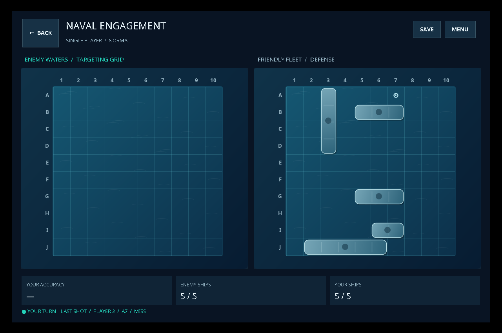
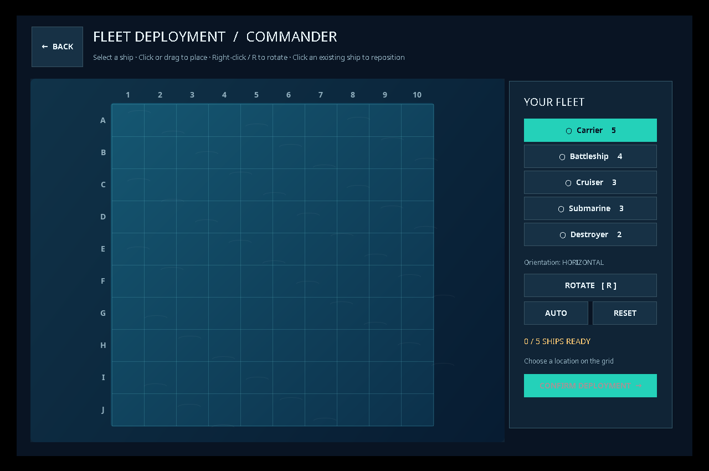

# BattleShip

A desktop implementation of the classic Battleship game, written in Java 21 using Swing and Java2D.

Play against the computer, share a keyboard with another player, or connect two computers directly over TCP. The game runs locally, requires no account or database, and has no external services.



## Features

- **Classic Battleship** — Two 10×10 grids, five ships per player, and standard turn-based gameplay.
- **Three AI difficulties** — Easy uses random targeting, Normal follows a hunt-and-target strategy, and Hard evaluates possible ship placements to make more informed shots.
- **Fleet placement** — Position ships manually, rotate them with `R` or right-click, or generate a random arrangement.
- **Custom rules** — Choose whether ships can touch each other, including diagonally.
- **Local multiplayer** — Play with someone on the same computer, with a privacy screen between turns.
- **Direct IP multiplayer** — Host or join a game over TCP without a dedicated server.
- **Save and resume** — Save an unfinished match locally and pick up where you left off.
- **Resizable interface** — Custom Java2D board rendering, visual feedback for shots, and an option to reduce animations.

There are no sounds, background services, or online dependencies.

## Screenshots

### Fleet placement

Arrange your ships before the match starts. You can place them individually or generate a complete fleet automatically.



### Gameplay

The battle screen shows your fleet, your opponent's grid, the current turn, and the results of previous shots.


## Getting started

### Requirements

- Java Development Kit (JDK) 21 or newer to build from source
- Windows or Linux

A packaged build with a bundled Java runtime does not require a separate Java installation.

### Run from source

Clone the repository:

```bash
git clone https://github.com/MohammadrezaAmani/BattleShip.git
cd BattleShip
```

On Linux:

```bash
bash scripts/run.sh
```

On Windows:

```bat
scripts\run.bat
```

These scripts compile and launch the game using the JDK. Gradle is not required.

### Build a JAR

On Linux:

```bash
bash scripts/build.sh
```

Then run:

```bash
java -jar build/distribution/BattleShip-Reborn.jar
```

If you already have a prebuilt JAR, you can launch it directly:

```bash
java -jar BattleShip-Reborn.jar
```

### Gradle

The project also supports Gradle 8.14 or newer:

```bash
gradle run
gradle test
```

A Gradle Wrapper is not included, so Gradle must be installed separately to use these commands. The first test run may require an internet connection to download JUnit dependencies.

### Native builds

To create a Linux application bundle with its own Java runtime:

```bash
bash scripts/package-linux.sh
```

Run the resulting application:

```bash
./build/native/BattleShipReborn/bin/BattleShipReborn
```

On Windows, use:

```bat
scripts\package-windows.bat
```

Native packages must be built on their target operating system. A Linux build cannot directly produce a Windows package.

## How to play

1. Select `NEW CAMPAIGN` from the main menu.
2. Choose an AI difficulty and decide whether ships are allowed to touch.
3. Place all five ships on your grid, or use `AUTO` to arrange them randomly.
4. Select `CONFIRM DEPLOYMENT` when your fleet is ready.
5. Click an unexplored cell on the enemy grid to fire.

Each player gets one shot per turn, regardless of whether it hits or misses. A ship sinks when all its cells have been hit. The first player to sink the entire opposing fleet wins.

### Controls

| Action | Control |
|---|---|
| Place a ship | Left-click |
| Rotate selected ship | `R` or right-click |
| Move a placed ship | Select it, then choose a new position |
| Generate a random fleet | `AUTO` |
| Clear fleet placement | `RESET` |
| Start the match | `CONFIRM DEPLOYMENT` |
| Fire at an enemy cell | Left-click on the enemy grid |
| Save the current match | `SAVE` |

Use `CONTINUE SAVED MATCH` from the main menu to resume a saved game.

## Game modes

### Single-player

Play against one of three computer opponents.

| Difficulty | Strategy |
|---|---|
| Easy | Chooses randomly among cells that have not been targeted |
| Normal | Searches for ships and follows up on successful hits |
| Hard | Evaluates possible placements of remaining ships and targets higher-probability cells |

The AI uses only information revealed during the match. It does not inspect your hidden ship positions when deciding where to shoot.

### Two players, one computer

Select `TWO PLAYERS · LOCAL` to play on the same machine.

Each player arranges their fleet separately. Between turns, the game displays a privacy screen so the next player cannot see the previous player's board.

### Two players over TCP

Select `TWO PLAYERS · DIRECT IP` on both computers.

On the first computer:

1. Select `HOST GAME`.
2. Choose a port, or keep the default `50505`.
3. Start hosting.

On the second computer:

1. Select `JOIN BY IP`.
2. Enter the host computer's IP address.
3. Enter the same port and connect.

Once connected, both players can arrange their fleets and start the match.

The host is responsible for validating moves and maintaining the authoritative game state. Each player receives only the opponent information they are allowed to see.

**Network notes**

- Both computers must be able to reach each other over TCP.
- The host's firewall must allow incoming connections on the selected port.
- For connections outside the local network, port forwarding or additional network configuration may be necessary.
- Connections behind CGNAT may not work without an intermediate networking solution.
- TCP traffic is not encrypted. This mode is intended for local or otherwise trusted networks.

If a connection drops, the guest can attempt to rejoin using `RECONNECT`.

## Saving games

Save files are stored in the current user's application data directory.

| Platform | Location |
|---|---|
| Linux | `${XDG_DATA_HOME:-~/.local/share}/battleship/savegame.json` |
| Windows | `%APPDATA%\BattleShip\savegame.json` |

Saves use versioned JSON. The game validates loaded data before restoring a match and keeps a `.bak` backup of the previous save.

Files are written to a temporary location before being moved into place, using an atomic move when supported by the filesystem.

No database is required.

## Building and testing

The project includes a headless test runner for checking game rules and simulating complete matches.

Run the test suite on Linux:

```bash
bash scripts/test.sh 1000
```

Run AI simulations:

```bash
java -Djava.awt.headless=true \
  -cp build/classes \
  com.battleship.AiBenchmark 500
```

The tests cover ship placement, overlapping ships, board boundaries, turn order, hit detection, sinking, victory conditions, save restoration, AI decisions, and complete headless matches.

The network tests also exercise communication between host and guest TCP sessions on localhost, including turn synchronization and opponent-state visibility.

JUnit 5 tests are available in `src/test` and can be run using:

```bash
gradle test
```

## Project structure

```text
src/
├── main/
│   └── java/com/battleship/
│       ├── domain/        # Boards, ships, coordinates and rules
│       ├── engine/        # Match state, turns and shot resolution
│       ├── ai/            # Computer opponent strategies
│       ├── app/           # Game sessions and controllers
│       ├── ui/            # Swing interface and Java2D rendering
│       ├── persistence/   # Local saves and settings
│       └── lan/           # TCP host/client communication
└── test/                  # Automated tests

scripts/                   # Build, run, test and packaging scripts
screenshots/               # Game screenshots
```

The game engine is independent of Swing. It handles game rules and state transitions, while the interface is responsible for rendering the current state and collecting player input.

The AI implementations operate on a restricted view of the match rather than the opponent's actual board.

## Current limitations

The main game modes are implemented, but a few features are outside the scope of this release:

- Salvo rules and custom challenge scenarios
- Permanent player statistics and graphical match replays
- Automatic rematches within an existing TCP session
- Encrypted network connections
- A Windows installer tested on a clean Windows installation
- Dragging an already placed ship directly to a new position

Placed ships can still be moved by selecting them and choosing a new location.


-------------------------------

Special thanks to ChatGPT.
  